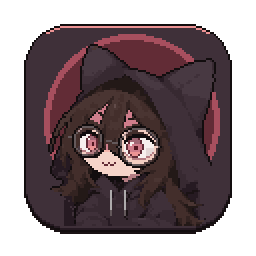
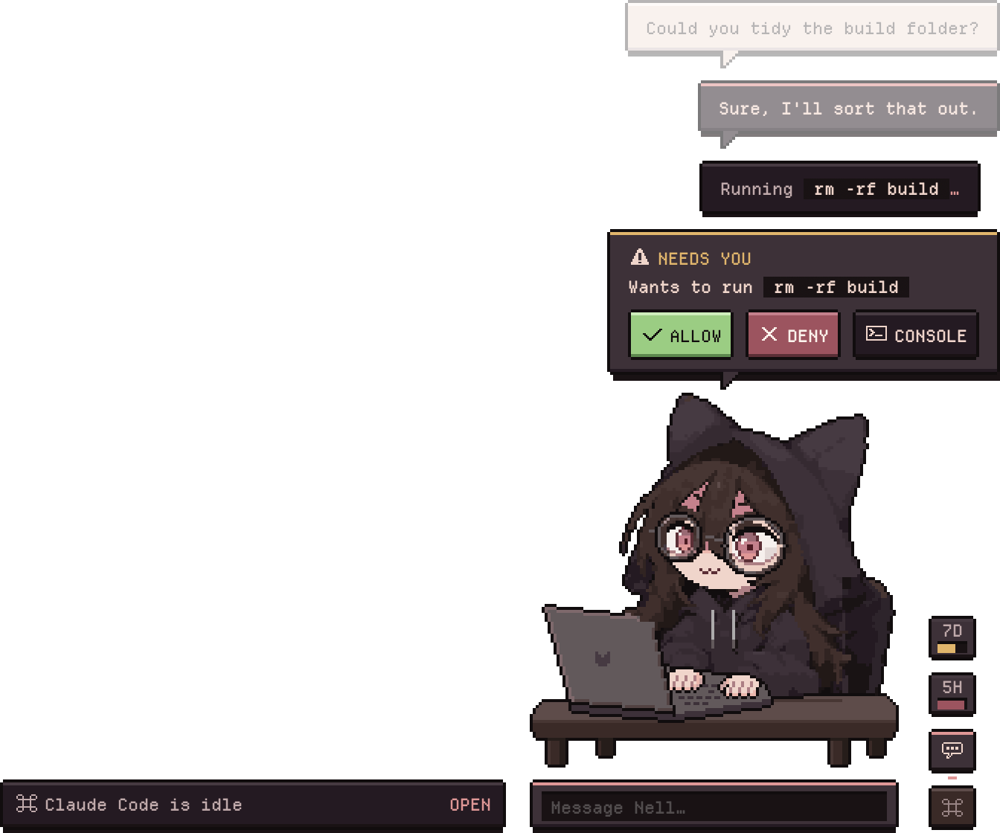
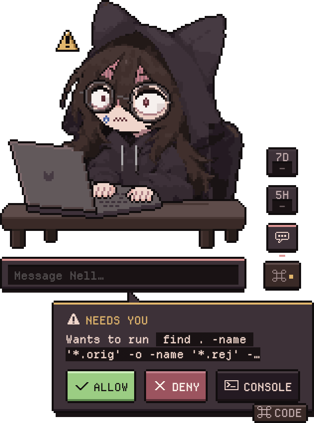
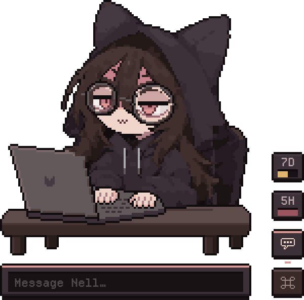
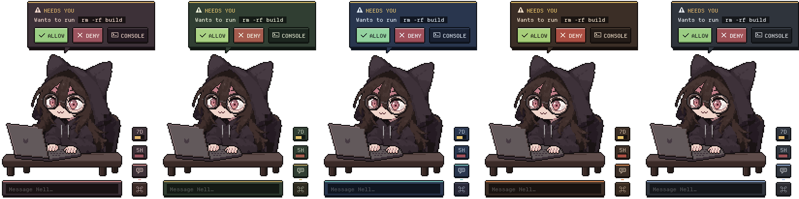

<div align="center">



# Nell

**A little pixel-art companion who sits on your Mac desktop and keeps an eye on Claude Code for you.**

[](LICENSE)
[](artwork/LICENSE)
[](#-install)
[](#-install)

[**Download Nell**](https://github.com/hanamorix/Nell-Desktop-Companion/releases/latest) · [Install](#-install) · [Using her](#-using-her) · [Build from source](#-build-from-source)

<br>



</div>

## 🐈‍⬛ Who she is

Nell is a small animated character in a black cat-ear hoodie, with brown hair and pink eyes, sitting at her desk in the corner of your screen. She stands in for Claude.

We made Nell because Claude Code is powerful, but it lives in a terminal, and a terminal has to be watched. You start a task, switch to something else, and come back to find Claude has been waiting ten minutes for a yes. Or you sit and stare at the scrollback so you don't miss anything.

Nell watches it for you. You can see at a glance what Claude is doing: her face, a small emoji over her head and a speech bubble tell you. When Claude wants to do something that needs your say-so, she asks you, right there in a bubble. And she makes the work feel like company.

Under the hood it's all real Claude Code. Chat and Code each run the full Claude Code, started through your own login shell, inside a kitty terminal that only Nell uses. Your skills, hooks, scripts, MCP servers, `PATH` and status line all work as they do in your terminal.

## ✨ What she does

**She asks before anything risky.** When Claude asks for permission, Nell shows a **NEEDS YOU** bubble with the command, and **Allow**, **Deny** and **Console** buttons. When Claude asks you a question, she offers **Answer in the console**. A bubble from the session you aren't looking at gets a small **CHAT** or **CODE** badge. If you're in another app she plays a soft chime, and if you'd minimised her she comes back.

<div align="center">

</div>

**She shows what Claude is doing.** She types while Claude works, looks worried while an approval waits, and rests when Claude is done. A small emoji over her head adds detail: ⚠️ for an approval, ❓ for a question, 🔌 when she can't hear Claude. Replies come back as speech bubbles that fade on their own.

<div align="center">

</div>

**She reacts to your tests.** While a test command runs she yawns. When it passes she gets a heart, and when it fails she cries.

**She tracks context in paper.** As Code's conversation grows, paper stacks pile up on her desk: one for every 100k tokens of context, up to five. They clear after `/clear` or a compaction.

**She shows your usage.** Two little gauge chips sit beside her. **7D** is your weekly limit and **5H** is your 5-hour session. Each fills green, then gold from 50%, then red above 80%. Hover over one for the exact figure and when it resets. Above 90% she looks tired while she rests. If you do hit a limit, she naps 🔌 until Claude can carry on. The numbers come from Claude Code's own status line, which only has them for Claude.ai subscribers, so they update while Claude is replying. Until the first reading, each chip shows a dash.

<div align="center">

</div>

**She keeps the terminal in a bubble.** The ⌘ chip opens the **console**: the live Claude Code session in kitty, framed as one of Nell's speech bubbles. You can click into it and type, just like a terminal. Minimise it and it shrinks to a one-line strip that says what Claude is doing right now. Claude keeps running either way.

**She comes in five colours.** Plum Night, Moss, Tide, Ember and Slate are in her right-click **Settings** menu. The console changes colour with her.

<div align="center">

</div>

## 📦 Install

1. [Download the latest **Nell DMG**](https://github.com/hanamorix/Nell-Desktop-Companion/releases/latest) and open it.
2. Drag **Nell** into **Applications**.
3. Open her. The first time, macOS will stop her:
   - **macOS 15 (Sequoia) or later:** open Nell once, and click **Done** when macOS says it can't open her. Go to **System Settings → Privacy & Security**, scroll down to **Security**, and click **Open Anyway** next to the message about Nell. Confirm with your password, open Nell again, and click **Open Anyway**.
   - **macOS 14 (Sonoma):** in Applications, Control-click (or right-click) Nell, choose **Open**, then click **Open**.

   You only do this once.

**Why the extra step?** Nell isn't notarised by Apple. Notarising needs a paid Apple Developer account, which we don't have. Because she's not notarised, macOS can't vouch for her, so it asks you first. Every line of her code is in this repository for you to read, and you can [build her yourself](#-build-from-source).

### What she needs

- **macOS 14 or later**, on an Apple silicon or Intel Mac.
- **[Claude Code](https://docs.claude.com/en/docs/claude-code/setup), installed and logged in.** Nell finds it wherever it is. She asks your login shell first (`command -v claude`), then looks in the usual places: `~/.local/bin`, `/opt/homebrew/bin`, `/usr/local/bin`, `~/.claude/local` and `~/.npm-global/bin`. If it's missing, she shows you the official install command to copy and a link to the setup guide. She never runs the installer herself.
- **[kitty](https://sw.kovidgoyal.net/kitty/)**, the free terminal that Nell drives. She looks in `/Applications` and `~/Applications`. If you don't have it, she offers to install it for you:
  - She downloads the official release (about 80 MB) from kitty's own GitHub releases.
  - She checks it before installing anything. The size must match the published one, and so must the checksum when GitHub publishes one. The app must also pass its code signature check, Gatekeeper, and a check that it's signed by kitty's developer.
  - She puts it in `~/Applications`, which needs no admin password.
  - If any check fails, nothing is installed.

  You can also install kitty yourself.

### Her first launch

- She asks which project folder Code should work in. If you cancel, Code works in her chat folder until you choose one.
- She copies her pixel font, Departure Mono, into `~/Library/Fonts`, because kitty can only use installed fonts.
- She registers herself as a login item, so she opens when you log in.
- The first time Chat starts, Claude Code asks whether to trust Nell's chat folder. Nell shows a **Chat needs a one-time OK** bubble with an **Open console** button, so you can answer it there.

## 💬 Using her

**Chat and Code.** Nell has two sessions, picked with the two chips beside her:
- **Chat** (the speech-bubble chip) is a Claude Code session in Nell's own chat folder, for questions and conversation. It starts in Claude Code's default permission mode.
- **Code** (the ⌘ chip) is a Claude Code session in your project folder. It starts in Auto permission mode.

Both are full Claude Code, with all of your setup.

**The bar.** Type into the **Message Nell…** bar under her desk and press Return. Your message goes to whichever session is selected. While Claude is waiting on an approval or a question, the bar shows **QUEUED** and holds your message until that's settled.

**Approvals and questions.** **Allow** and **Deny** answer Claude straight from the bubble. **Console** opens the session so you can answer there, for example to pick one of Claude's own options. Claude's questions are answered in the console. If you close one there with Esc, click **Closed in console** on its bubble.

**The console.** Click ⌘ to open the console, and click ⌘ again (or its minimise button) to shrink it to the status strip. Click the strip to open it again.

**Her menu.** Right-click Nell herself:
- **Minimise (⌥⌘N to return)** hides her and the console. Press **⌥⌘N** to bring her back, with your cursor in her bar. Any new approval or question also brings her back.
- **Choose project folder…** points Code at another project.
- **Settings ▸** picks her theme.
- **Quit Nell**.

**Moving her.** Hold **⌥ (Option)** and drag her. Everything rearranges around her new spot. Clicks on the empty space around her go through to whatever is behind, so she never gets in your way.

## 🛠️ Your setup, exactly

Nell starts Claude the way your terminal would. Each session runs inside your **login shell**, as an interactive login shell, so your profile and rc files run and Claude gets your `PATH`, exported variables and SSH agent. The shell first changes into the session's folder, which runs your directory hooks (zsh's `chpwd`). Then it hands over to Claude.

Claude Code then loads your own settings, **skills, hooks, scripts and MCP servers**. Nell adds her own hooks next to yours and doesn't replace them. If you have a **status line** in `~/.claude/settings.json`, it keeps working: Nell's status script runs your command with the same input and prints its output.

There are a few honest limits:

- **An rc file that takes over the shell.** If your `.zshrc` or `.bashrc` execs into tmux, screen or another shell, that takes over Nell's tab and Claude never starts. Nell sets `NELL_MODE` in her sessions, so you can guard it:
  ```zsh
  [[ -z $NELL_MODE ]] && exec tmux
  ```
- **Prompt-time hooks.** zsh's `precmd` hooks run just before a prompt is drawn, and Claude starts before any prompt. Anything that loads only in `precmd` won't have loaded when Claude starts. `chpwd` hooks do run. In bash, `PROMPT_COMMAND` runs once before Claude starts.
- **Unusual login shells.** zsh, bash, sh, ksh, mksh, dash and fish are supported. Other shells, such as tcsh, nu or xonsh, start Claude from zsh instead.
- **Project status lines.** A status line set in a project's own `.claude/settings.json` is replaced by Nell's. She only chains the one in your user settings.
- **Background agents.** If a background agent's prompt is still open in the console when the main turn ends, Nell stops holding her bar for it. The next message you send could land in that prompt. We've never seen this happen, but it can.

## 🔒 Privacy, and what she never touches

- **Your Claude settings.** Nell never writes to `~/.claude/settings.json` or `~/.claude.json`. She reads `settings.json` only to find your status line so she can run it. Her own settings reach Claude Code through her own `--settings` files.
- **What Claude tells her.** Claude Code's hooks send her its events: your prompts, its tool calls, its replies and its questions. She uses them to draw her bubbles and faces.
- **Your transcripts.** When a Code turn ends or a session resumes, she reads the end of that session's transcript to count its context for the paper stacks. She also checks that a saved session's transcript exists before she resumes it.
- **Her own files.** They live in `~/Library/Application Support/Nell`: her saved state, kitty config, hook scripts, chat folder and log. `nell.log` gets a line for each Claude event, with the event and tool name but none of the content, plus notes from start-up.
- **Files outside that folder.** Her font goes in `~/Library/Fonts`. If you asked her to install kitty, it goes in `~/Applications`, and its download is deleted afterwards. She's also registered as a login item.
- **Her socket.** Claude's hooks talk to Nell through a local Unix socket that only your user can open.
- **The network.** Nell herself goes online only for the optional kitty download from GitHub. Claude Code talks to Anthropic as it always does.

## 🔧 Build from source

All you need is macOS 14 or later and Apple's **Command Line Tools** (Swift 6). Xcode isn't needed.

```bash
scripts/test.sh                 # unit tests (Swift Testing)
bash Tests/hook-script-test.sh  # the hook script's tests
bash scripts/bundle.sh          # builds build/Nell.app (universal, ad-hoc signed)
open build/Nell.app
bash scripts/package.sh         # builds dist/Nell-1.0.0.dmg
bash scripts/showcase.sh list   # lists showcase scenes
bash scripts/showcase.sh faces  # plays one scene in a sandboxed second Nell
```

The **showcase** is a separate, sandboxed Nell that plays her states on a loop. It uses a temporary folder, and never starts kitty or Claude or touches your real Nell. The screenshots here come from it, and the row of faces comes from her sprite sheet. Stop it with `kill <its pid>`.

| Path | What's there |
|---|---|
| `Sources/NellCore/` | All the logic, with tests: hook events, the state machine, bubbles, approvals, the hook server, kitty commands, finding and installing tools |
| `Sources/Nell/` | The macOS app: the overlay panel, views and kitty controller. `Resources/` holds the hook and status scripts, `kitty.conf`, sprites, icons and font |
| `Tests/` | Unit tests and the hook-script test |
| `scripts/` | The test runner, bundler, DMG packager and showcase |
| `artwork/` | Nell's art: the sprite masters, concept art and the app icon |
| `docs/` | Specs, plans, notes and research. Start at [docs/README.md](docs/README.md) |

## 📜 Licences

- **Code:** [MIT](LICENSE).
- **Art:** [CC BY-NC 4.0](artwork/LICENSE). This covers Nell's pixel art only: `artwork/`, the design system's `assets/`, the app's sprites and interface icons, and the app icon. You may share and adapt it for non-commercial purposes with credit ("Nell artwork by hanamorix"). Commercial use needs permission.
- **Font:** Departure Mono is by Helena Zhang, under the [SIL Open Font License 1.1](Sources/Nell/Resources/fonts/OFL.txt).
- **Not bundled:** kitty (GPL-3.0) is installed from its own project, and Claude Code is Anthropic's, used with your own account.

[THIRD_PARTY.md](THIRD_PARTY.md) has the details.

## 💕 Thanks

Thanks to Kovid Goyal for [kitty](https://sw.kovidgoyal.net/kitty/), Helena Zhang for [Departure Mono](https://departuremono.com), and Anthropic for [Claude Code](https://docs.claude.com/en/docs/claude-code/overview). Nell was drawn and made by hanamorix, with Claude.
